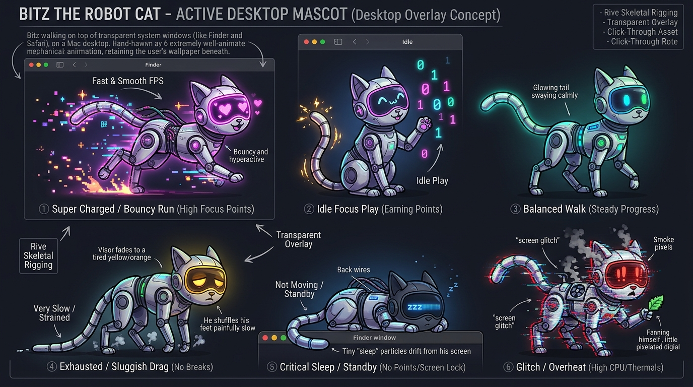

# Bitz the Cyber Cat (`bitz-mac`)

<p align="center">
  
</p>

<p align="center">
  
  
  
  
</p>

**Bitz the Cyber Cat** is a native, lightweight macOS cyberpunk desktop companion built with **Swift**, **SwiftUI**, and **AppKit**. Bitz sits quietly in the bottom-right corner of your screen in a 100% click-through floating overlay (`NSPanel`), reacting in real time to your **coding focus**, **offline breaks**, and **live Apple Silicon hardware sensors** (CPU die temperature in `°C` and Mach kernel CPU load `%`).

---

## ✨ Key Features

- **100% Click-Through Desktop Overlay (`MascotOverlayPanel`)**
  - Renders inside a borderless, non-activating `250×250` floating `NSPanel` (`ignoresMouseEvents = true`, `.canJoinAllSpaces`, `.fullScreenAuxiliary`, `.stationary`).
  - Never steals keyboard focus, never intercepts mouse clicks over your IDE or browser, and **never alters your macOS desktop wallpaper**.
- **Real Apple Silicon Hardware Telemetry (`AppleSiliconHardwareSensors`)**
  - **Live Die Temperature (`°C`)**: Queries Apple Silicon `IOHIDEventSystemClient` on-die thermal sensors (`PrimaryUsagePage: 0xFF00`, `PrimaryUsage: 5`) without requiring `sudo` or root privileges.
  - **Live CPU Load (`%`)**: Samples Darwin Mach kernel `host_statistics(HOST_CPU_LOAD_INFO)` delta ticks (`user`, `system`, `nice`, `idle`).
  - **Live HUD Pill**: Displays real-time hardware stats directly beneath Bitz (`e.g., 51.8°C • 14% CPU • 50 PTS`).
- **Privacy-First Focus & Break Tracking (`ActivityMonitorService`)**
  - Uses only standard macOS `NSWorkspace.shared.frontmostApplication` (active app bundle ID) and `CGEventSource.secondsSinceLastEventType` (idle timer).
  - **Zero Accessibility permissions (`AXIsProcessTrusted`) and zero keystroke/mouse logging**.
- **Menu Bar Control Center (`MenuBarExtra`)**
  - Click the `cat.fill` icon in the macOS Menu Bar at any time to inspect live hardware sensor readings, active app classification, idle time, **Pet Bitz (`<3  <3`)**, or preview any emotional state.

---

## ⚡ Emotions & Wellness Points (`PTS`)

Bitz's mood is driven by **Wellness Points (`PTS`)** on a scale from **`0.0` to `100.0`** (starting at `50.0 PTS`), sampled every **5 seconds** with timer coalescing (`< 1%` CPU overhead):

### How `PTS` Changes
| Activity | Condition | `PTS` Delta |
| :--- | :--- | :--- |
| **Productive Coding / Dev Work** | Active app is an IDE or terminal (`Antigravity IDE`, `Xcode`, `VS Code`, `Cursor`, `Terminal`, `iTerm2`, `Warp`, `IntelliJ`, `Zed`, `Sublime Text`) | **`+0.5 PTS`** / tick |
| **Unproductive / Distraction** | Active app is a browser, chat client, or non-dev app (`Safari`, `Firefox`, `WhatsApp`, `Teams`, etc.) | **`-1.5 PTS`** / tick |
| **Short Idle (`1 – 10 min`)** | No keyboard or mouse input for `>= 60s` | **Paused (`On Break`)** — no point drain |
| **Offline Break (`> 10 min`)** | Stepping away from the Mac for more than `10.0` minutes | **`+5.0 PTS` per minute** restored on return |
| **Thermal Overheat Override** | Apple Silicon CPU die temperature **`> 80.0 °C`** or `ProcessInfo.ThermalState` is `.serious` / `.critical` | Immediate override to **`.overheating`** (`"SYSTEM HOT! > <"`) until cooled |

### Bitz's 5 Behavioral States (`BitzState`)
| State | Trigger Threshold | Visor Color | Visual & Animation Behavior |
| :--- | :--- | :--- | :--- |
| **Super Charged** (`.superCharged`) | `80.0 – 100.0 PTS` | **Neon Magenta (`#FF007F`)** | Happy `^  ^` LED visor, fast `2.0x` breathing & tail wag |
| **Balanced** (`.balanced`) | `40.0 – 79.9 PTS` | **Electric Cyan (`#00F0FF`)** | Calm glowing cyan eyes, steady `1.0x` breathing & tail sway |
| **Overworked** (`.overworked`) | `15.0 – 39.9 PTS` | **Warning Amber (`#FFB000`)** | Tired `-  -` squint, drooping ears, sluggish `0.4x` breathing |
| **Burnout / Standby** (`.burnout`) | `0.0 – 14.9 PTS` | **Dim Cyan (`#00F0FF`)** | Tucks into a sleeping cat loaf (`0.0x` motion) with **`Z Z Z`** on the visor |
| **Overheating** (`.overheating`) | **`> 80.0 °C`** or `.critical`/`.serious` thermal state | **Critical Red (`#FF1E1E`)** | Distressed `>  <` visor, high-frequency horizontal glitch, **`"SYSTEM HOT! > <"`** speech banner |

> **Petting Bitz**: Clicking **"Pet Bitz (`<3`)"** in the Menu Bar fires the `triggerPet` state machine trigger and lights up Bitz's visor with glowing neon magenta hearts (`<3  <3`).

---

## 🏗️ Architecture & Project Layout

```text
bitz-mac/
├── Package.swift                              # SwiftPM manifest (BitzCore library, Bitz executable, BitzTests)
├── Scripts/
│   └── package_and_run.sh                     # Builds, bundles, ad-hoc signs, and launches build/Bitz.app
├── src/
│   ├── App/
│   │   ├── BitzApp.swift                      # NSApplicationDelegate + MenuBarExtra live telemetry UI
│   │   └── Info.plist                         # LSUIElement=true agent bundle configuration (no Dock icon)
│   ├── Executable/
│   │   └── main.swift                         # Native macOS app entry point (BitzApp.main())
│   ├── Services/
│   │   ├── WellnessPointEngine.swift          # Reactive PTS state engine & Rive state machine adapter seam
│   │   └── ActivityMonitorService.swift       # AppleSiliconHardwareSensors (IOHID + Mach) & activity monitor
│   └── Views/
│       ├── MascotOverlayPanel.swift           # Click-through, non-activating floating NSPanel
│       └── MascotOverlayView.swift            # Cyberpunk cat vector rig, reactive LED visor & live HUD pill
├── Tests/
│   └── BitzTests/                             # 23 deterministic XCTest unit tests
│       ├── WellnessPointEngineTests.swift
│       ├── ActivityMonitorServiceTests.swift
│       └── MascotOverlayPanelTests.swift
└── docs/
    ├── rive-setup.md                          # Rive BitzStateMachine input contract & asset guide
    └── verification-quickstart.md             # Verification & testing guide
```

---

## 🚀 Getting Started

### Requirements
- **macOS 14.0 (Sonoma)** or later (Apple Silicon recommended for on-die `IOHIDEventSystemClient` temperature sensors)
- **Xcode 15.4+** / Xcode Command Line Tools (`/usr/bin/swift`)

### 1. Build, Package & Launch `Bitz.app`
Run the included packaging script to compile the executable, bundle `build/Bitz.app` with its `LSUIElement` `Info.plist`, ad-hoc sign it, and launch it:

```bash
./Scripts/package_and_run.sh
```

Once launched:
1. Look at the **bottom-right corner** of your screen to see Bitz and the live hardware HUD pill (`°C • CPU % • PTS`).
2. Look at the **top-right macOS Menu Bar** and click the **cat icon (`Bitz`)** to view live telemetry or interact with Bitz.

### 2. Run the Unit Test Suite
```bash
/usr/bin/swift test
```

---

## 🔧 Customizing Productive Apps & Thresholds

You can customize which apps count as productive or adjust the idle and thermal thresholds in [`ActivityMonitorService.swift`](src/Services/ActivityMonitorService.swift):

```swift
let customMonitor = ActivityMonitorService(
    engine: engine,
    productiveBundleIDs: [
        "com.google.antigravity-ide",
        "com.apple.dt.Xcode",
        "com.microsoft.VSCode",
        "com.apple.Terminal",
        "com.figma.Desktop" // Add any custom creative/dev bundle IDs
    ],
    idleBreakThresholdSeconds: 60.0,            // Enter break mode after 60s of no input
    overheatingTemperatureThresholdCelsius: 80.0 // Trigger SYSTEM HOT! above 80°C
)
```

---

## 📄 License

Released as open-source software under the [MIT License](https://opensource.org/licenses/MIT).
