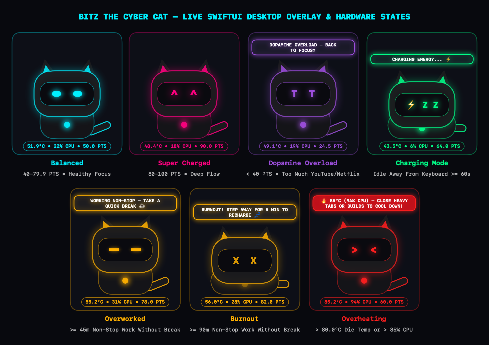

# Bitz the Cyber Cat (`bitz-mac`)

<p align="center">
  
</p>

<p align="center">
  
  
  
  
</p>

**Bitz the Cyber Cat** is a native, lightweight macOS cyberpunk desktop companion built with **Swift**, **SwiftUI**, and **AppKit**. Bitz sits quietly in the bottom-right corner of your screen inside a 100% click-through floating overlay (`NSPanel`), rendered with a procedural 60 FPS SwiftUI vector rig (`TimelineView`) that reacts in real time to your **coding focus**, **offline breaks**, and **live Apple Silicon hardware sensors** (CPU die temperature in `°C` and Mach kernel CPU load `%`).

---

## ✨ Key Features

- **100% Click-Through Desktop Overlay (`MascotOverlayPanel`)**
  - Renders inside a borderless, non-activating floating `NSPanel` (`ignoresMouseEvents = true`, `.canJoinAllSpaces`, `.fullScreenAuxiliary`, `.stationary`).
  - Never steals keyboard focus, never intercepts mouse clicks over your IDE or browser, and **never alters your macOS desktop wallpaper**.
- **See-Through Hologram Opacity (`AvatarOpacityStore`)**
  - Adjustable transparency presets (`Solid 100%`, `Translucent 80%`, `Hologram 60%`, `Ghost 40%`, `Stealth 25%`) and `±10%` steps so text and code behind Bitz are always readable.
- **4-Corner Desktop Positioning (`ScreenCornerAnchor`)**
  - Anchor Bitz to `Bottom-Right (Default)`, `Bottom-Left`, `Top-Right`, or `Top-Left` directly from the Menu Bar.
- **Manual Avatar Resizing (`AvatarScaleStore`)**
  - Scale Bitz from `50%` to `175%` (`Small 60%`, `Medium 80%`, `Default 100%`, `Large 125%`, `XL 150%`) with automatic bottom/right corner re-anchoring.
- **Expressive Procedural Animations (`MascotOverlayView`)**
  - Cyberpunk cat silhouette with moving paws/trot cycle, natural eye-blink intervals, glowing LED visor, and ambient particles (neon sparks in Super Charged, binary bits in Balanced, drifting ZZZs in Charging, and ear steam puffs in Overheat).
- **Real Apple Silicon Hardware Telemetry (`AppleSiliconHardwareSensors`)**
  - **Live Die Temperature (`°C`)**: Queries Apple Silicon `IOHIDEventSystemClient` on-die thermal sensors (`PrimaryUsagePage: 0xFF00`, `PrimaryUsage: 5`) without requiring `sudo` or root privileges.
  - **Live CPU Load (`%`)**: Samples Darwin Mach kernel `host_statistics(HOST_CPU_LOAD_INFO)` delta ticks (`user`, `system`, `nice`, `idle`).
  - **Live HUD Pill**: Displays real-time hardware stats directly beneath Bitz (`e.g., 51.8°C • 14% CPU • 50 PTS`).
- **Privacy-First Focus, Safari & Break Tracking (`ActivityMonitorService`)**
  - Uses standard macOS `NSWorkspace.shared.frontmostApplication` and `CGEventSource.secondsSinceLastEventType`.
  - Zero Accessibility permissions (`AXIsProcessTrusted`) and zero keystroke/mouse logging.
  - Inspects active tabs across Firefox, Chrome, Brave, Edge, Arc, Opera, Vivaldi, and Safari.
  - 1-click Menu Bar controls to mark any custom app or domain as **Always Productive** or **Distraction**.
- **Session Persistence & macOS Sleep/Wake Break Crediting**
  - Focus points, work streaks, and custom rules automatically persist in `UserDefaults`.
  - Automatically listens to macOS sleep, display sleep, and screen lock/unlock events, restoring energy after offline breaks.
- **Launch at Login (`SMAppService`)**
  - Toggle native macOS auto-start at login directly from the Menu Bar.
- **Menu Bar Control Center (`MenuBarExtra`)**
  - Click the `cat.fill` icon in the macOS Menu Bar to inspect live sensors, pet Bitz (`<3  <3`), change size/opacity/corner, or test states.

---

## ⚡ Emotions & Wellness Points (`PTS`)

Bitz's mood is driven by **Wellness Points (`PTS`)** on a scale from **`0.0` to `100.0`** (starting at `50.0 PTS`), sampled every **5 seconds** with timer coalescing (`< 1%` CPU overhead):

### How `PTS` & Continuous Work Streak Change
| Activity | Condition | Effect |
| :--- | :--- | :--- |
| **Productive Coding & Office Work** | Active app is a Developer IDE/Terminal (`Antigravity IDE`, `Xcode`, `VS Code`, `Cursor`, `Windsurf`, `Zed`, `Terminal`, `iTerm2`, `Warp`, `Ghostty`, `JetBrains`, `Docker`, `Postman`, `TablePlus`), Office Suite (`Word`, `Excel`, `PowerPoint`, `Outlook`, `OneNote`, `Pages`, `Numbers`, `Keynote`, `Notes`, `Calendar`, `Mail`), or Collaboration/Design tool (`Teams`, `Slack`, `Zoom`, `Notion`, `Obsidian`, `Linear`, `Figma`, `Miro`, `Canva`) | **`+0.5 PTS`** / tick (increases continuous work streak) |
| **Too Much YouTube / Netflix / Browsing** | Active app is a browser, video player, or distraction (`Firefox`, `Safari`, `Chrome`, `WhatsApp`, `Discord`, etc.) | **`-1.5 PTS`** / tick — drains below `40 PTS` into **`.dopamineSad`** (`T  T`) |
| **Working Too Long Without a Break** | Continuous productive work `>= 45 min` (`Overworked`) or `>= 90 min` (`Burnout`) without stepping away | Triggers **`.overworked`** (`-  -`) -> **`.burnout`** (`X  X`) with break reminders |
| **Idle / Away from Keyboard (`>= 60s`)** | No keyboard or mouse input for `>= 60s` | Enters **`.charging`** (`⚡ Z Z`), recharging **`+0.5 PTS`** per tick & clearing work fatigue |
| **Offline Break Return (`> 2 min`)** | Returning after stepping away from the Mac | **`+5.0 PTS` per minute** restored and resets continuous work streak to `0m` |
| **Thermal / CPU Spike Override** | Apple Silicon CPU die temperature **`> 80.0 °C`**, CPU load **`> 85%`**, or `.serious`/`.critical` thermal pressure | Immediate override to **`.overheating`** (`>  <`) with an actionable cool-down alert above Bitz |

### Bitz's Behavioral States (`BitzState`)
| State | Trigger Condition | Visor Color | Visual & Speech Bubble Behavior |
| :--- | :--- | :--- | :--- |
| **Super Charged** (`.superCharged`) | `80.0 – 100.0 PTS` (`< 45m` work streak) | **Neon Magenta (`#FF007F`)** | Happy `^  ^` LED visor, fast `2.0x` breathing & tail wag |
| **Balanced** (`.balanced`) | `40.0 – 79.9 PTS` (`< 45m` work streak) | **Electric Cyan (`#00F0FF`)** | Calm glowing cyan eyes, steady `1.0x` breathing & tail sway |
| **Sad / Dopamine Overload** (`.dopamineSad`) | `< 40.0 PTS` (Watching YouTube/Netflix/browsing too long) | **Dopamine Violet (`#9D4EDD`)** | Sad crying `T  T` eyes, drooping ears, **`"DOPAMINE OVERLOAD — BACK TO FOCUS?"`** |
| **Overworked** (`.overworked`) | `>= 45 min` non-stop work without a break | **Warning Amber (`#FFB000`)** | Tired `-  -` squint, drooping ears, **`"WORKING NON-STOP — TAKE A QUICK BREAK ☕"`** |
| **Burnout** (`.burnout`) | `>= 90 min` non-stop work without a break | **Warning Amber (`#FFB000`)** | Exhausted `X  X` loaf (`0.0x` motion), **`"BURNOUT! STEP AWAY FOR 5 MIN TO RECHARGE 💤"`** |
| **Charging** (`.charging`) | `>= 60s` without touching keyboard or mouse | **Cyber Green (`#00FF88`)** | Cozy loaf with **`⚡ Z Z`** visor, **`"CHARGING ENERGY... ⚡"`** |
| **Overheating** (`.overheating`) | **`> 80.0 °C`** die temp or **`> 85%`** CPU load | **Critical Red (`#FF1E1E`)** | Glitching `>  <` visor + actionable alert: **`"🔥 85°C (92% CPU) — CLOSE HEAVY TABS OR BUILDS TO COOL DOWN!"`** |

> **Petting Bitz**: Clicking **"Pet Bitz (`<3`)"** in the Menu Bar fires the `triggerPet` state machine trigger and lights up Bitz's visor with glowing neon magenta hearts (`<3  <3`).

---

## 🏗️ Architecture & Project Layout

```text
bitz-mac/
├── Package.swift                              # SwiftPM manifest (BitzCore library, Bitz executable, BitzTests)
├── Scripts/
│   └── package_and_run.sh                     # Builds, bundles, ad-hoc signs, and launches build/Bitz.app
├── src/
│   ├── App/
│   │   ├── BitzApp.swift                      # NSApplicationDelegate + MenuBarExtra live telemetry UI
│   │   └── Info.plist                         # LSUIElement=true agent bundle configuration (no Dock icon)
│   ├── Executable/
│   │   └── main.swift                         # Native macOS app entry point (BitzApp.main())
│   ├── Services/
│   │   ├── WellnessPointEngine.swift          # Reactive PTS state engine & Rive state machine adapter seam
│   │   └── ActivityMonitorService.swift       # AppleSiliconHardwareSensors (IOHID + Mach) & activity monitor
│   └── Views/
│       ├── MascotOverlayPanel.swift           # Click-through, non-activating floating NSPanel
│       └── MascotOverlayView.swift            # Cyberpunk cat vector rig, reactive LED visor & live HUD pill
├── Tests/
│   └── BitzTests/                             # 33 deterministic XCTest unit tests
│       ├── WellnessPointEngineTests.swift
│       ├── ActivityMonitorServiceTests.swift
│       └── MascotOverlayPanelTests.swift
└── docs/
    ├── ARCHITECTURE.md                        # Layered system architecture & invariants
    ├── STATE_MACHINE.md                       # 7-state emotional machine & Rive contract
    └── ACCEPTANCE_CRITERIA.md                 # Requirements traceability & test matrix
```

---

## 🚀 Getting Started

### Requirements
- **macOS 14.0 (Sonoma)** or later (Apple Silicon recommended for on-die `IOHIDEventSystemClient` temperature sensors)
- **Xcode 15.4+** / Xcode Command Line Tools (`/usr/bin/swift`)

### 1. Build, Package & Launch `Bitz.app`
Run the included packaging script to compile the executable, bundle `build/Bitz.app` with its `LSUIElement` `Info.plist`, ad-hoc sign it, and launch it:

```bash
./Scripts/package_and_run.sh
```

Once launched:
1. Look at the **bottom-right corner** of your screen to see Bitz and the live hardware HUD pill (`°C • CPU % • PTS`).
2. Look at the **top-right macOS Menu Bar** and click the **cat icon (`Bitz`)** to view live telemetry or interact with Bitz.

### 2. Run the Unit Test Suite
```bash
/usr/bin/swift test
```

---

## 🔧 Customizing Productive Apps & Thresholds

You can customize which apps count as productive or adjust the idle and thermal thresholds in [`ActivityMonitorService.swift`](src/Services/ActivityMonitorService.swift):

```swift
let customMonitor = ActivityMonitorService(
    engine: engine,
    productiveBundleIDs: [
        "com.google.antigravity-ide",
        "com.apple.dt.Xcode",
        "com.microsoft.VSCode",
        "com.apple.Terminal",
        "com.figma.Desktop" // Add any custom creative/dev bundle IDs
    ],
    idleBreakThresholdSeconds: 60.0,            // Enter break mode after 60s of no input
    overheatingTemperatureThresholdCelsius: 80.0 // Trigger SYSTEM HOT! above 80°C
)
```

---

## 📄 License

Released as open-source software under the [MIT License](https://opensource.org/licenses/MIT).
