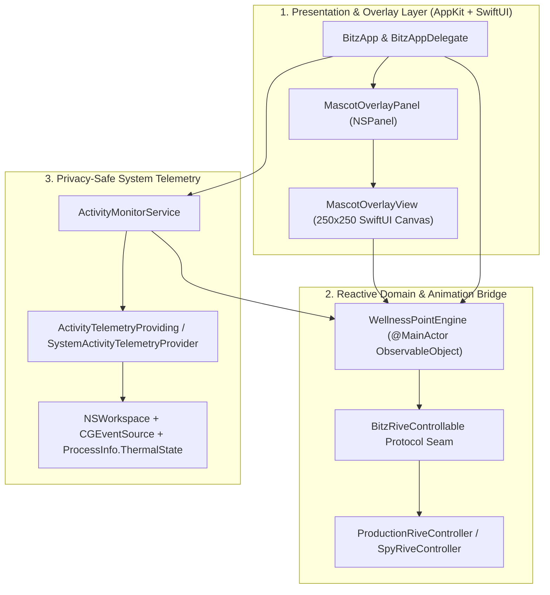

# Bitz macOS Desktop Companion — System Architecture

## 1. Architectural Overview

**Bitz the Cyber Cat** (`bitz-mac`) is a native macOS 14.0+ desktop companion built with **Swift 6** (`swift-tools-version: 6.0`, strict `@MainActor` concurrency), **SwiftUI**, **AppKit**, and **CoreGraphics**.

The system is structured into three cleanly separated layers:

---

## 2. Module & File Responsibilities

| Layer | File | Primary Symbols | Responsibility |
| :--- | :--- | :--- | :--- |
| **Presentation & Lifecycle** | `src/App/BitzApp.swift` | `BitzApp`, `BitzAppDelegate` | Application lifecycle, `MenuBarExtra` status item (`"Pet Bitz"`, manual avatar resizing presets & `±10%` step controls, and state override triggers), and initialization of `MascotOverlayPanel`, `AvatarScaleStore`, `WellnessPointEngine`, and `ActivityMonitorService`. |
| **Window Management & Scaling** | `src/App/Window/MascotOverlayPanel.swift` | `MascotOverlayPanel`, `AvatarScaleStore`, `AvatarSizePreset` | Borderless, transparent, floating, non-activating `NSPanel` with `ignoresMouseEvents = true` anchored at the bottom-right of `NSScreen.main?.visibleFrame`, plus `AvatarScaleStore` managing `50%–175%` (`0.50...1.75`) manual scale presets, `±10%` steps, and `UserDefaults` (`"avatarScaleFactor"`) persistence. Retains screen parameters observer token with clean removal in `isolated deinit`. |
| **Mascot Canvas** | `src/Views/MascotOverlayView.swift` | `MascotOverlayView` | `250x250` base transparent SwiftUI canvas (scaled proportionally by `scaleStore.scaleFactor`) rendering Bitz's cyberpunk silhouette, state-reactive LED visor (`#00F0FF`, `#FF007F`, `#9D4EDD`, `#FFB000`, `#00FF88`, `#FF1E1E`), standby `"ZZZ"` badge, and `"SYSTEM HOT! > <"` thermal warning banner. |
| **Domain & Rive Bridge** | `src/Services/WellnessPointEngine.swift` | `WellnessPointEngine`, `BitzState`, `BitzRiveControllable`, `ProductionRiveController`, `SpyRiveController` | Evaluates work ticks (`+0.5` / `-1.5`), offline break recovery (`+5.0` pts/min when `> 2.0` min), thermal overrides, and synchronizes Rive `BitzStateMachine` inputs (`speedMultiplier = 0.6` for `.charging`, `2.5` for `.overheating` with `isStandby = false`). Hardened against non-finite values and clock skew. |
| **System Telemetry** | `src/Services/ActivityMonitorService.swift` | `ActivityMonitorService`, `ActivityTelemetryProviding`, `SystemActivityTelemetryProvider` | Polls active app bundle identifiers, user idle time (`CGEventSource`), browser tab metadata via single-lookup `activeBrowserTab()`, and thermal pressure (`ProcessInfo.ThermalState` / CPU temperature `> 80.0°C`) with coalesced timers and synchronous `MainActor.assumeIsolated` notification handling. |

---

## 3. Window & Presentation Invariants (`MascotOverlayPanel`)

`MascotOverlayPanel` enforces the desktop overlay contract (`FR-001`, `DIR-001`, `DIR-002`):

| Property | Enforced Value | Architectural Purpose |
| :--- | :--- | :--- |
| `styleMask` | `[.nonactivatingPanel, .borderless]` | Removes window chrome and prevents focus stealing. |
| `level` | `.floating` | Floats above standard desktop windows. |
| `isOpaque` / `backgroundColor` | `false` / `.clear` | Ensures 100% transparent pixel composition around the mascot. |
| `hasShadow` | `false` | Eliminates rectangular window shadow artifacts. |
| `ignoresMouseEvents` | `true` | WindowServer routes 100% of clicks and drags (`0ms` latency) to underlying apps. |
| `collectionBehavior` | `[.canJoinAllSpaces, .fullScreenAuxiliary, .stationary]` | Persists across Mission Control Spaces and full-screen workspaces. |
| `canBecomeKey` / `canBecomeMain` | `false` / `false` | Never intercepts keyboard focus from the user's active IDE or terminal. |
| Frame Geometry & Scaling | `maxX - scaledWidth - 20`, `minY + 20` (`250 * s` pt, `s ∈ 0.50...1.75`, default `250x250` pt) | Proportionally scales panel and canvas (`125x125` to `437.5x437.5` pt) while anchoring Bitz in the bottom-right corner of `NSScreen.main?.visibleFrame`. |
| Screen Observer Token Cleanup | `screenParametersObserverToken: (any NSObjectProtocol)?` | Safely retained and removed in `@MainActor isolated deinit` to prevent memory leaks and dangling closures. |
| Wallpaper Invariant | Zero calls to `setDesktopImageURL` | Strictly a floating transparent overlay; never modifies the user's desktop wallpaper (`C-001`). |

---

## 4. Concurrency, Performance & Privacy Guarantees

1. **Swift 6 `@MainActor` Isolation & Synchronous Notification Handling (`C-002`)**:
   - `WellnessPointEngine`, `ActivityMonitorService`, `MascotOverlayPanel`, and `BitzRiveControllable` are isolated to `@MainActor`, eliminating data races between telemetry timers, `@Published` state mutations, and AppKit/SwiftUI view rendering.
   - Sleep/wake and screen lock notifications (`screensDidSleepNotification`, `willSleepNotification`, `screensDidWakeNotification`, `didWakeNotification`) dispatch on `queue: .main` and execute synchronously via `MainActor.assumeIsolated`. This eliminates asynchronous detached `Task { @MainActor }` suspension races, ensuring sleep timestamps are saved before macOS suspends the process.
2. **Telemetry Performance & Browser Tab Single-Lookup Optimization (`F9`)**:
   - `ActivityTelemetryProviding` defines `activeBrowserTab() -> (url: String?, title: String?)`. During each 5-second sample tick, `performSampleTick()` retrieves the URL and title in a single pass.
   - For Firefox, this eliminates redundant file decompression of `recovery.jsonlz4` from disk.
   - For Safari, this halves AppleScript execution frequency via `NSAppleScript`.
   - `ActivityMonitorService` uses a single main run loop `Timer` with `20%` timer coalescing tolerance (`timer.tolerance = intervalSeconds * 0.2`) and lightweight metadata lookups, maintaining `< 1.5%` CPU usage.
3. **CPU (`< 2%`) & Memory (`< 70MB`) Budgets (`NFR-001`, `NFR-002`, `DIR-003`)**:
   - Continuous idle operations average $< 1.5\%$ CPU on Apple Silicon.
   - `MascotOverlayPanel` bounds rendering to a single `250x250` buffer (`backing: .buffered`), maintaining a memory footprint well under `40MB`.
4. **App Sandbox & Privacy Compliance (`C-003`)**:
   - Zero Accessibility (`AXIsProcessTrusted`, `AXUIElement`) or keylogging (`CGEvent.tapCreate`) APIs are used.
   - Only `NSWorkspace.shared.frontmostApplication?.bundleIdentifier`, `CGEventSource.secondsSinceLastEventType(.combinedSessionState, eventType: .null)`, and `ProcessInfo.processInfo.thermalState` are read in-memory.
