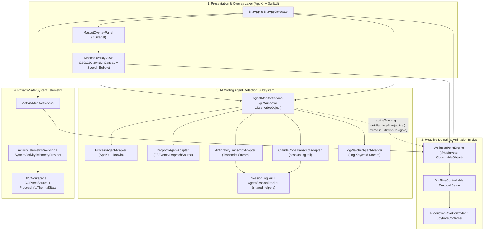
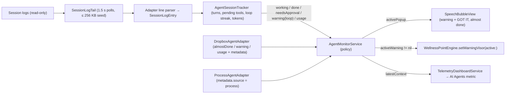

# Bitz macOS Desktop Companion — System Architecture

## 1. Architectural Overview

**Bitz the Cyber Cat** (`bitz-mac`) is a native macOS 14.0+ desktop companion built with **Swift 6** (`swift-tools-version: 6.0`, strict `@MainActor` concurrency), **SwiftUI**, **AppKit**, and **CoreGraphics**.

The system is structured into three cleanly separated layers:

---

## 2. Module & File Responsibilities

| Layer | File | Primary Symbols | Responsibility |
| :--- | :--- | :--- | :--- |
| **Presentation & Lifecycle** | `src/App/BitzApp.swift` | `BitzApp`, `BitzAppDelegate` | Application lifecycle, `MenuBarExtra` status item (`"Pet Bitz"`, manual avatar resizing presets & `±10%` step controls, and state override triggers), and initialization of `MascotOverlayPanel`, `AvatarScaleStore`, `WellnessPointEngine`, and `ActivityMonitorService`. |
| **Window Management & Scaling** | `src/App/Window/MascotOverlayPanel.swift` | `MascotOverlayPanel`, `AvatarScaleStore`, `AvatarSizePreset` | Borderless, transparent, floating, non-activating `NSPanel` with `ignoresMouseEvents = true` anchored at the bottom-right of `NSScreen.main?.visibleFrame`, plus `AvatarScaleStore` managing `50%–175%` (`0.50...1.75`) manual scale presets, `±10%` steps, and `UserDefaults` (`"avatarScaleFactor"`) persistence. Retains screen parameters observer token with clean removal in `isolated deinit`. |
| **Mascot Canvas** | `src/Views/MascotOverlayView.swift` | `MascotOverlayView` | `250x250` base transparent SwiftUI canvas (scaled proportionally by `scaleStore.scaleFactor`) rendering Bitz's cyberpunk silhouette, state-reactive LED visor (`#00F0FF`, `#FF007F`, `#9D4EDD`, `#FFB000`, `#00FF88`, `#FF1E1E`), standby `"ZZZ"` badge, and `"SYSTEM HOT! > <"` thermal warning banner. |
| **Domain & Rive Bridge** | `src/Services/WellnessPointEngine.swift` | `WellnessPointEngine`, `BitzState`, `BitzRiveControllable`, `ProductionRiveController`, `SpyRiveController` | Evaluates work ticks (`+0.5` / `-1.5`), offline break recovery (`+5.0` pts/min when `> 2.0` min), thermal overrides, and synchronizes Rive `BitzStateMachine` inputs (`speedMultiplier = 0.6` for `.charging`, `2.5` for `.overheating` with `isStandby = false`). Hardened against non-finite values and clock skew. Exposes the agent warning visor input `isWarningVisorActive` / `setWarningVisor(active:)`: Amber `visorColor` unless overheating, without changing state, points or thresholds (see `docs/STATE_MACHINE.md` §8). |
| **System Telemetry** | `src/Services/ActivityMonitorService.swift` | `ActivityMonitorService`, `ActivityTelemetryProviding`, `SystemActivityTelemetryProvider` | Polls active app bundle identifiers, user idle time (`CGEventSource`), browser tab metadata via single-lookup `activeBrowserTab()`, and thermal pressure (`ProcessInfo.ThermalState` / CPU temperature `> 80.0°C`) with coalesced timers and synchronous `MainActor.assumeIsolated` notification handling. |
| **Agent Coordination** | `src/Services/AgentMonitorService.swift`, `src/Models/AgentModels.swift` | `AgentMonitorService`, `AgentDefinition`, `AgentEvent`, `AgentPopupState`, `AgentWarning`, `AgentContextReading`, `AgentSignalSettings` | Central orchestrator for agent adapters, catalog persistence, and speech bubble display prioritization (giving `.needsApproval` and `.done` precedence over routine wellness text). Owns all agent signal policy (§5): `usage` readings into per-agent context readings, context threshold crossing per agent, a 5 s stall sweep, a single warning slot (`activeWarning`) with another agent's approval override and restoration, acknowledgement (**Got it** / menu **Dismiss Agent Warning**), and signal settings persisted through the injected `UserDefaults`. |
| **Agent Adapters** | `src/Services/DropboxAgentAdapter.swift`, `src/Services/AntigravityTranscriptAdapter.swift`, `src/Services/ClaudeCodeTranscriptAdapter.swift`, `src/Services/ProcessAgentAdapter.swift`, `src/Services/LogWatcherAgentAdapter.swift` | `DropboxAgentAdapter`, `AntigravityTranscriptAdapter`, `ClaudeCodeTranscriptAdapter`, `ProcessAgentAdapter`, `LogWatcherAgentAdapter` | Pluggable adapters monitoring drop-box JSON files (`FSEvents`, now also `almostDone` / `warning` / `usage` kinds with optional `metadata`), Antigravity and Claude Code session logs (turns, context usage, tool-loop and pending-tool signals), running processes, and keyword logs. `ProcessAgentAdapter` tags every event with `metadata.source = process` (app presence), so its `done` never clears a warning or ends a turn. |
| **Session-Log Helpers** | `src/Services/SessionLogTail.swift`, `src/Services/AgentSessionTracker.swift` | `SessionLogTail`, `AgentSessionTracker`, `SessionLogEntry` | Shared by both session-log adapters. `SessionLogTail` reads only appended bytes (at most the last 256 KB on attach) and picks the session to follow; `AgentSessionTracker` turns parsed entries into `working` / `done` / `needsApproval` / `warning(loop)` / `usage` events and primes turn state from the seed via `prime(fromSeed:)`. |
| **Agent Signal Presentation** | `src/Views/SpeechBubbleView.swift`, `src/Services/TelemetryDashboardService.swift`, `src/Models/TelemetryModels.swift`, `src/Views/Settings/AgentsSettingsTabView.swift`, `src/App/BitzApp.swift` | `SpeechBubbleContent`, `AgentTelemetry`, `AgentsSettingsTabView`, `BitzMenuBarContentView` | Amber warning bubble with a **GOT IT** button (the only agent bubble that takes clicks), magenta "almost done" bubble, `Claude ctx 148k · 74%` context text on the AI Agents metric, the "Agent Signals & Warnings" settings card, and the menu bar **Dismiss Agent Warning** item. |
| **Agent Hook Installer** | `src/Services/AgentHookInstaller.swift` | `AgentHookInstaller` | Safe, reversible generator for Claude Code `Stop`/`PermissionRequest` hooks in `~/.claude/settings.json` and CLI scripts with automated backups. |

---

## 3. Window & Presentation Invariants (`MascotOverlayPanel`)

`MascotOverlayPanel` enforces the desktop overlay contract (`FR-001`, `DIR-001`, `DIR-002`):

| Property | Enforced Value | Architectural Purpose |
| :--- | :--- | :--- |
| `styleMask` | `[.nonactivatingPanel, .borderless]` | Removes window chrome and prevents focus stealing. |
| `level` | `.floating` | Floats above standard desktop windows. |
| `isOpaque` / `backgroundColor` | `false` / `.clear` | Ensures 100% transparent pixel composition around the mascot. |
| `hasShadow` | `false` | Eliminates rectangular window shadow artifacts. |
| `ignoresMouseEvents` | `true` | WindowServer routes 100% of clicks and drags (`0ms` latency) to underlying apps. |
| `collectionBehavior` | `[.canJoinAllSpaces, .fullScreenAuxiliary, .stationary]` | Persists across Mission Control Spaces and full-screen workspaces. |
| `canBecomeKey` / `canBecomeMain` | `false` / `false` | Never intercepts keyboard focus from the user's active IDE or terminal. |
| Frame Geometry & Scaling | `maxX - scaledWidth - 20`, `minY + 20` (`250 * s` pt, `s ∈ 0.50...1.75`, default `250x250` pt) | Proportionally scales panel and canvas (`125x125` to `437.5x437.5` pt) while anchoring Bitz in the bottom-right corner of `NSScreen.main?.visibleFrame`. |
| Screen Observer Token Cleanup | `screenParametersObserverToken: (any NSObjectProtocol)?` | Safely retained and removed in `@MainActor isolated deinit` to prevent memory leaks and dangling closures. |
| Wallpaper Invariant | Zero calls to `setDesktopImageURL` | Strictly a floating transparent overlay; never modifies the user's desktop wallpaper (`C-001`). |

---

## 4. Concurrency, Performance & Privacy Guarantees

1. **Swift 6 `@MainActor` Isolation & Synchronous Notification Handling (`C-002`)**:
   - `WellnessPointEngine`, `ActivityMonitorService`, `MascotOverlayPanel`, and `BitzRiveControllable` are isolated to `@MainActor`, eliminating data races between telemetry timers, `@Published` state mutations, and AppKit/SwiftUI view rendering.
   - Sleep/wake and screen lock notifications (`screensDidSleepNotification`, `willSleepNotification`, `screensDidWakeNotification`, `didWakeNotification`) dispatch on `queue: .main` and execute synchronously via `MainActor.assumeIsolated`. This eliminates asynchronous detached `Task { @MainActor }` suspension races, ensuring sleep timestamps are saved before macOS suspends the process.
2. **Telemetry Performance & Browser Tab Single-Lookup Optimization (`F9`)**:
   - `ActivityTelemetryProviding` defines `activeBrowserTab() -> (url: String?, title: String?)`. During each 5-second sample tick, `performSampleTick()` retrieves the URL and title in a single pass.
   - For Firefox, this eliminates redundant file decompression of `recovery.jsonlz4` from disk.
   - For Safari, this halves AppleScript execution frequency via `NSAppleScript`.
   - `ActivityMonitorService` uses a single main run loop `Timer` with `20%` timer coalescing tolerance (`timer.tolerance = intervalSeconds * 0.2`) and lightweight metadata lookups, maintaining `< 1.5%` CPU usage.
3. **CPU (`< 2%`) & Memory (`< 70MB`) Budgets (`NFR-001`, `NFR-002`, `DIR-003`)**:
   - Continuous idle operations average $< 1.5\%$ CPU on Apple Silicon.
   - `MascotOverlayPanel` bounds rendering to a single `250x250` buffer (`backing: .buffered`), maintaining a memory footprint well under `40MB`.
4. **App Sandbox & Privacy Compliance (`C-003`)**:
   - Zero Accessibility (`AXIsProcessTrusted`, `AXUIElement`) or keylogging (`CGEvent.tapCreate`) APIs are used.
   - For wellness telemetry, only `NSWorkspace.shared.frontmostApplication?.bundleIdentifier`, `CGEventSource.secondsSinceLastEventType(.combinedSessionState, eventType: .null)`, and `ProcessInfo.processInfo.thermalState` are read in-memory.
   - Agent session logs (Claude Code, Antigravity) are read locally and read-only; only token counts, tool names and SHA-256 fingerprints of tool inputs are kept, in memory only. No prompt, response or code text is stored or displayed.

---

## 5. Agent Signals: Context Gauge, Almost Done & Warnings (#38)

Adapters parse, `AgentMonitorService` owns the policy, and the views and the engine only present (DIRECTIVE_001).

### 5.1 Session-Log Adapters

| Aspect | `ClaudeCodeTranscriptAdapter` | `AntigravityTranscriptAdapter` |
| :--- | :--- | :--- |
| Session followed | Most recently modified `~/.claude/projects/<project>/<session>.jsonl`, depth 1 only, so nested subagent logs are never followed. Lines with `isSidechain == true`, user lines with `isMeta == true`, and `<synthetic>` assistant placeholders (all-zero usage) are skipped. | Most recently modified `~/.gemini/antigravity/brain/<id>/.system_generated/logs/transcript.jsonl`. |
| Turn start | `working` on the first assistant line after a prompt, so a local slash command that gets no reply never starts a turn. | `working` on a `USER_INPUT` line. |
| Turn end | `done` on `stop_reason == end_turn`; silent end on a `turn_duration` / `stop_hook_summary` system line or a `[Request interrupted` marker. | `done` on a `PLANNER_RESPONSE` with `status == DONE` and no tool calls. |
| Context tokens | `input_tokens + cache_creation_input_tokens + cache_read_input_tokens` of the latest assistant line. | `input_tokens + cache_read_tokens` of the latest `PLANNER_RESPONSE`. |
| Pending tools | `tool_use` ids without a matching `tool_result.tool_use_id`. | Tool calls of the latest `PLANNER_RESPONSE`, cleared by any later line (no call ids). |
| Loop streak reset | A different call, `compact_boundary`, or a new session. | A different call or a new session. |
| Approval | Not read from the session log; the optional `PermissionRequest` hook from `AgentHookInstaller` reports it through the drop-box. | An `ask_question` tool call, flat `{name, args}` or legacy `function.name`, emits `needsApproval` (PR #65, #63). |

Shared behaviour (`SessionLogTail`, `AgentSessionTracker`):

- **Incremental reads**: polls run every 1.5 s. A poll with no appended bytes reads 0 bytes; a truncated or recreated file is skipped without replay. A failed `stat` changes nothing, so it can never replay the log.
- **Session switching**: the adapter keeps following the current session while it was modified within the last 10 s (`idleSwitchDelay`), then moves to the newest one. While the current file is fresh, a poll stats only that file; the directory scan runs only once it goes quiet or disappears.
- **Attach / seed**: on attach, at most the last 256 KB (`seedLimit`) is read and the first partial line dropped. `tracker.reset()` and `prime(fromSeed:)` silently replay the seed (no events), then clear the loop streak. A turn already in progress is tracked without replaying bubbles, also when its prompt lies before the seed window (agent output after the last turn end counts as an active turn). One `usage` event with `seed = true` follows and carries the primed `turnActive`, `pendingTools` and, when known, `contextTokens`.
- **Activity heartbeat**: each later poll that saw appended bytes emits one `usage` event, which the monitor treats as activity.
- **Loop detection**: fingerprint = tool name + SHA-256 of the input serialized with sorted keys. One `warning(loop)` fires at 4 identical consecutive calls; text between calls does not break the streak.

### 5.2 Monitor Policy (`AgentMonitorService`)

| Concern | Shipped Rule |
| :--- | :--- |
| Signal settings | `AgentSignalSettings` stored as JSON at `Bitz.AgentMonitor.SignalSettings` in the injected `UserDefaults` (`BitzAppDelegate` passes its own domain; tests pass isolated suites). Every change is clamped (threshold `50...99` %, stall timeout `1...30` min, windows `> 0`), persisted and applied immediately. Defaults: all four signals on, threshold `90` %, stall `3` min, window Claude Code `200_000`, Antigravity `1_000_000`, any other agent `200_000`. |
| Context crossing | Per agent: when `percent >= threshold` and the agent's warning has not fired yet, it fires once. No warning is raised for a `seed` reading or with the toggle off. It re-arms when the percent drops below the threshold. Changing a window recomputes stored readings without raising a warning. Percent is capped at 100. |
| Stall sweep | Every 5 s while monitoring: a session that sends `usage` heartbeats (a session-log adapter; drop-box-only agents never stall) with `turnActive`, not awaiting approval, `pendingTools == 0`, not yet fired and no activity for the stall timeout raises one `stall` warning. Any `working` or `usage` event resets it. |
| Warning slot | One `activeWarning`; a newer warning replaces it. It is cleared by **Got it**, the menu bar **Dismiss Agent Warning**, the same agent's `done` or `needsApproval`, or disabling that agent. `working`, `almostDone` and other agents' `done` never replace the warning bubble. |
| Approval override | Another agent's `needsApproval` takes the bubble while the warning stays active (amber visor). That agent's next `working`, `almostDone`, `done` or suppressed `warning` event restores the warning bubble; `usage` never does. The same holds when a warning arrives while another agent's approval is already showing: the approval keeps the bubble. |
| App presence | A `done` tagged `metadata.source = process` never clears a warning or ends a turn, because the Claude desktop app shares the `claude` agent ID with Claude Code. |
| Existing toggles | With "Show Agent Speech Bubbles" off, no bubble is shown, but `activeWarning`, the visor and the gauge still update. Disabling an agent clears its warning, context reading and session state. |
| Gauge | `TelemetryDashboardService` passes `latestContext` into `AgentTelemetry.context`; the last reading stays after the turn ends (when context is most worth checking) until a newer one replaces it, the agent is disabled or monitoring stops. While an agent is active, `formattedSummary` appends `Claude ctx 148k · 74%`, `compactBadge` appends ` · 74%` and the menu bar title ` 74%`; with none active they read `No agents currently active · Claude ctx 148k · 74%`, `CTX 74%` and `Ctx 74%`. |
| Warning visor | `BitzAppDelegate` maps `agentMonitor.$activeWarning != nil` (deduplicated, main queue) to `engine.setWarningVisor(active:)`. The engine receives only this flag, never agent policy. |

Bitz adds no new hooks and never writes to the Claude Code settings file for these signals. There are no cost, rate-limit or CPU alerts, because those signals lack a verified data source.
