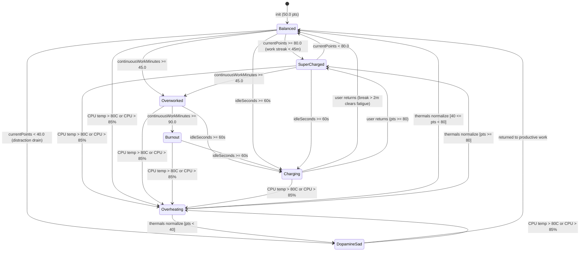
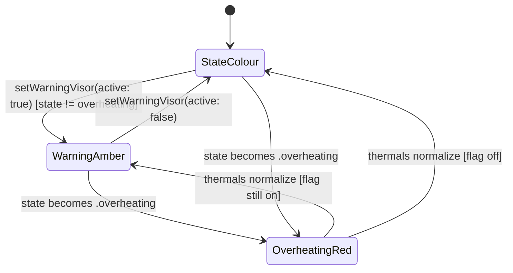

# Bitz State Machine & Wellness Point Engine Specification

## 1. Overview

Bitz's visual mood, animation speed, and LED visor telemetry are driven by the reactive `WellnessPointEngine` (`src/Services/WellnessPointEngine.swift`) bridged to the Rive state machine (`BitzStateMachine`) via the `BitzRiveControllable` protocol seam (`FR-002`, `FR-003`, `FR-004`, `C-004`).

---

## 2. Rive `BitzStateMachine` Input Contract

All Rive mutations target state machine `"BitzStateMachine"` inside asset `"bitz_cyber_cat"` (`BitzRiveInputName`):

| Input Identifier | Rive Type | Swift Type | Domain Range / Allowed Values | Purpose |
| :--- | :--- | :--- | :--- | :--- |
| `speedMultiplier` | `Number` | `Float` | `0.0 ... 2.5` (`2.5`, `2.0`, `1.0`, `0.6`, `0.4`, `0.35`, `0.0`) | Controls idle breathing, ear twitch, paws trot, and tail wag playback speed. |
| `visorColor` | `Number` | `Float` | `0.0` (Cyan `#00F0FF`), `1.0` (Magenta `#FF007F`), `2.0` (Amber `#FFB000`), `3.0` (Red `#FF1E1E`), `4.0` (Violet `#9D4EDD`), `5.0` (Green `#00FF88`) | Drives LED visor and internal ear/tail neon color blends. Forced to `2.0` while the agent warning visor is active, except when overheating (§8). |
| `isStandby` | `Boolean` | `Bool` | `true` / `false` | Transitions Bitz into/out of curled loaf sleep/charging mode. |
| `isGlitching` | `Boolean` | `Bool` | `true` / `false` | Enables/disables cyberpunk chromatic aberration and jitter during CPU thermal spikes. |
| `triggerPet` | `Trigger` | `Void` | One-shot impulse | Plays the happy purr / `<3` visor reaction when triggered from the Menu Bar. |

---

## 3. Wellness Scoring Mechanics (`WellnessPointEngine`)

- **Initial Score**: `50.0` points (`BitzState.balanced`).
- **Clamping Bounds**: `minPoints = 0.0`, `maxPoints = 100.0` (`0.0 ... 100.0`).
- **Work Tick Evaluation (`evaluateWorkTick(isProductiveApp:tickDurationMinutes:)`)**:
  - Productive Foreground App / Whitelisted Tab (`isProductiveApp == true`): **`+0.5` points** per tick (increases continuous work streak).
  - Unproductive Streaming / Distraction Site (`isProductiveApp == false`): **`-1.5` points** per tick (drains into `.dopamineSad` when $< 40$ PTS, reduces continuous work streak by 5m).
- **Charging Idle Mode (`setChargingState(true)`)**:
  - Recharges **`+0.5` points** per tick and reduces continuous work fatigue (by 5m per tick) when away from keyboard $\ge 60$s.
- **Offline Break Recovery (`applyOfflineBreak(minutes:)`)**:
  - When `minutes <= 2.0`: **`+0.0` points** (no change; short pauses do not reset fatigue).
  - When `minutes > 2.0`: **`+5.0 * minutes` points**, clamped to `100.0`, and resets continuous work streak to `0.0m`.
- **Work Fatigue Streaks**:
  - Continuous work $\ge 45$ min without a break transitions to **`.overworked`** (`-  -`).
  - Continuous work $\ge 90$ min without a break transitions to **`.burnout`** (`X  X`).

---

## 4. State Hierarchy & Evaluation Priority Invariants

When evaluating state transitions via `evaluateState()`, Bitz enforces a strict 4-level deterministic priority hierarchy:

```
┌─────────────────────────────────────────────────────────────┐
│  Priority 1: Overheating Override (Thermal Protection)      │
│  - Trigger: CPU temp > 80.0°C or CPU load > 85%            │
│  - State: .overheating (Red Visor, Glitching, Speed 2.5)    │
└──────────────────────────────┬──────────────────────────────┘
                               │ (thermals normal)
                               ▼
┌─────────────────────────────────────────────────────────────┐
│  Priority 2: Charging Mode (User Away from Keyboard)        │
│  - Trigger: Idle duration >= 60.0s                          │
│  - State: .charging (Green Visor, Standby Loaf, Speed 0.6)  │
└──────────────────────────────┬──────────────────────────────┘
                               │ (user active)
                               ▼
┌─────────────────────────────────────────────────────────────┐
│  Priority 3: Fatigue / Work Streak Overrides                │
│  - Sub-priority 3a: continuousWorkMinutes >= 90.0m          │
│    -> State: .burnout (Amber Visor, Standby Loaf, Speed 0.0)│
│  - Sub-priority 3b: continuousWorkMinutes >= 45.0m          │
│    -> State: .overworked (Amber Visor, Sluggish, Speed 0.4) │
└──────────────────────────────┬──────────────────────────────┘
                               │ (continuousWorkMinutes < 45m)
                               ▼
┌─────────────────────────────────────────────────────────────┐
│  Priority 4: Focus Points / Mood (Base Wellness State)      │
│  - currentPoints >= 80.0 -> .superCharged (Magenta, Spd 2.0)│
│  - 40.0 <= currentPoints < 80.0 -> .balanced (Cyan, Spd 1.0)│
│  - currentPoints < 40.0 & productive -> .balanced (recovery)│
│  - currentPoints < 40.0 & distraction -> .dopamineSad       │
│    (Violet Visor, Crying, Speed 0.35)                       │
└─────────────────────────────────────────────────────────────┘
```

1. **Priority 1: Thermal Overheating Override (`.overheating`)**
   Hardware thermal safety always takes absolute precedence over work streaks and point scores. If CPU core temperature exceeds `80.0°C` or CPU usage exceeds `85%`, Bitz enters `.overheating` with red visor, chromatic aberration glitching, speed multiplier 2.5, and `isStandby = false` regardless of current fatigue or points. When thermals recover, the underlying state is cleanly restored.
2. **Priority 2: Charging Mode (`.charging`)**
   When the user is away from keyboard for $\ge 60$s, charging overrides work streak and focus score display. Bitz assumes a loaf posture with green visor, sleep breathing at speed multiplier 0.6, and `isStandby = true`.
3. **Priority 3: Continuous Work Fatigue (`.burnout` > `.overworked`)**
   If continuous productive work reaches $\ge 90$m without a break $> 2$m, Bitz enters `.burnout` (`isStandby = true`, speed 0.0, speech alert). If continuous work is $\ge 45$m (and $< 90$m), Bitz enters `.overworked` (speed 0.4, amber visor). Fatigue overrides focus points until a break $> 2$m resets `continuousWorkMinutes` to `0.0`.
4. **Priority 4: Wellness Focus Score (`.superCharged` > `.balanced` > `.dopamineSad`)**
   In the absence of overrides and fatigue:
   - $\ge 80.0$ PTS: `.superCharged` (energetic trot, magenta visor, speed 2.0).
   - $40.0 \dots <80.0$ PTS: `.balanced` (steady trot, cyan visor, speed 1.0).
   - $< 40.0$ PTS: `.dopamineSad` (crying visor, violet visor, speed 0.35) unless the user has actively switched to a productive app, in which case `.balanced` is displayed to encourage recovery.

---

## 5. Behavioral States & Threshold Mapping (`BitzState`)

| `BitzState` | Point / Streak Condition | `speedMultiplier` | `visorColor` | `isStandby` | `isGlitching` | `activeSpeechBubbleText` | Visual Telemetry |
| :--- | :--- | :--- | :--- | :--- | :--- | :--- | :--- |
| **`.superCharged`** | `80.0 ... 100.0` PTS ($< 45$m work) | `2.0` | `1.0` (Magenta `#FF007F`) | `false` | `false` | `nil` | High-energy trot, neon sparks drifting, `^  ^` visor |
| **`.balanced`** | `40.0 ..< 80.0` PTS ($< 45$m work) | `1.0` | `0.0` (Cyan `#00F0FF`) | `false` | `false` | `nil` | Steady breathing & paws, floating binary bits, blinking cyan eyes |
| **`.dopamineSad`** | $< 40.0$ PTS (Streaming/distraction drain) | `0.35` | `4.0` (Violet `#9D4EDD`) | `false` | `false` | `"DOPAMINE OVERLOAD — BACK TO FOCUS?"` | Drooping ears, crying `T  T` visor |
| **`.overworked`** | Work streak $\ge 45$ min without break | `0.4` | `2.0` (Amber `#FFB000`) | `false` | `false` | `"WORKING NON-STOP — TAKE A QUICK BREAK ☕"` | Sluggish walk, tired `-  -` squint visor |
| **`.burnout`** | Work streak $\ge 90$ min without break | `0.0` | `2.0` (Amber `#FFB000`) | `true` | `false` | `"BURNOUT! STEP AWAY FOR 5 MIN TO RECHARGE 💤"` | Curled loaf posture, exhausted `X  X` visor |
| **`.charging`** | Idle $\ge 60$s without mouse/keyboard input | `0.6` | `5.0` (Emerald Green `#00FF88`) | `true` | `false` | `"CHARGING ENERGY... ⚡"` | Cozy loaf posture, `⚡ Z Z` visor, drifting `Zzz` particles |
| **`.overheating`** | Thermal Override ($> 80.0^\circ\text{C}$ or $> 85\%$ CPU) | `2.5` | `3.0` (Critical Red `#FF1E1E`) | `false` | `true` | `"🔥 ... CLOSE HEAVY APPS TO COOL DOWN!"` | Glitch vibration, steam puffs from ears, `>  <` visor |

---

## 6. Hardened Edge Case Scenarios & Invariant Protections

The engine is hardened against 11 distinct edge-case scenarios spanning IEEE-754 floating-point corner cases, clock skew, epoch timestamps, sleep/wake telemetry races, Rive synchronization, and asynchronous event debouncing:

### Scenario 1: NaN / Non-Finite Points Sanitization
- **Description**: IEEE-754 floating-point arithmetic or corrupted external inputs (`Double.nan`, `Double.infinity`, `-Double.infinity`) supplied during engine initialization or via `setPoints(_:)`.
- **Trigger Condition**: Corrupted `UserDefaults` payload or abnormal math calculation producing `NaN` or `±Inf`.
- **Expected Hardened Behavior**: `WellnessPointEngine.sanitizePoints(_:)` intercepts non-finite values before assignment. If `!points.isFinite`, the engine safely falls back to `defaultPoints = 50.0`, resulting in a valid `.balanced` state instead of propagating `NaN` through the entire state machine. Finite values are clamped to `[0.0, 100.0]`.
- **Test Verification Method**:
  - `WellnessPointEngineTests.testNaNInitialPointsDoesNotPoisonEngineAndFallsBackToDefaultPoints`
  - `WellnessPointEngineTests.testSetPointsWithNonFiniteValuesSafelySanitizesToDefault`

### Scenario 2: NaN / Non-Finite Work Tick Duration Sanitization
- **Description**: Sample tick interval calculation or time delta resulting in `NaN` or `±Infinity` passed into `evaluateWorkTick(isProductiveApp:tickDurationMinutes:)`.
- **Trigger Condition**: Timer jitter, zero division, or hardware clock calculation returning non-finite tick duration.
- **Expected Hardened Behavior**: In `evaluateWorkTick`, `safeTickDuration` verifies `tickDurationMinutes.isFinite && tickDurationMinutes >= 0.0`. If non-finite or negative, the duration safely falls back to `0.0`. `continuousWorkMinutes` remains finite and uncorrupted, allowing fatigue thresholds (`.overworked` and `.burnout`) to function predictably.
- **Test Verification Method**:
  - `WellnessPointEngineTests.testEvaluateWorkTickWithNaNDurationDoesNotCorruptWorkStreak`
  - `WellnessPointEngineTests.testEvaluateWorkTickWithNegativeDurationClampsToZero`
  - `WellnessPointEngineTests.testApplyOfflineBreakWithNonFiniteOrNegativeMinutesDoesNotCorruptState`

### Scenario 3: Clock Skew & Backward Time Jump Clamping
- **Description**: Local system time adjusted backwards (e.g. NTP synchronization, daylight saving time transition, or manual clock adjustment) during app runtime or while asleep.
- **Trigger Condition**: `now < lastTimestamp` during persistence restoration or `now < sleepRecordedAt` upon system wake.
- **Expected Hardened Behavior**: All elapsed time calculations employ non-negative clamping: `max(0.0, now - lastTimestamp)` and `max(0.0, elapsedSec)`. Negative elapsed durations evaluate to `0.0` minutes, preventing points deductions, inverted fatigue adjustments, or unintended offline break triggers.
- **Test Verification Method**:
  - `WellnessPointEngineTests.testPersistenceWithBackwardClockSkewClampsToZeroElapsed`
  - `ActivityMonitorServiceTests.testSleepWakeWithNegativeElapsedClockSkewDoesNotAwardBreak`

### Scenario 4: Epoch Zero (0.0) Timestamp Persistence Rejection
- **Description**: Restoring persisted session timestamp where `lastSavedTime` is `0.0` (uninitialized Unix epoch, Jan 1 1970).
- **Trigger Condition**: Fresh installation, uninitialized `UserDefaults` double key, or corrupt preferences file.
- **Expected Hardened Behavior**: In pre-hardened code, `Date().timeIntervalSince1970 - 0.0` evaluated to $\approx 1.79 \times 10^9$ seconds ($\approx 2.98 \times 10^7$ minutes), granting an immediate 100 PTS recovery and wiping real work streak data (an unintended 54-year offline break). Hardened code enforces `lastTimestamp >= Self.minimumValidTimestamp` (`1_704_067_200.0`, Jan 1 2024). Epoch 0 timestamps are rejected, preserving existing points and fatigue.
- **Test Verification Method**:
  - `WellnessPointEngineTests.testPersistenceRejectsEpochZeroTimestampAndDoesNotGrantFiftyFourYearBreak`

### Scenario 5: Future Timestamp Persistence Rejection
- **Description**: Persisted timestamp recorded significantly in the future (e.g. test artifact, manual clock manipulation, or future skew).
- **Trigger Condition**: `lastTimestamp > now + maxFutureTimestampSkewSeconds (60.0s)`.
- **Expected Hardened Behavior**: Timestamps exceeding 60 seconds into the future are flagged as corrupted and rejected without applying break recovery or modifying the current state.
- **Test Verification Method**:
  - `WellnessPointEngineTests.testPersistenceRejectsFutureTimestampBeyondAllowedSkew`

### Scenario 6: Sleep & Wake Break Double-Counting Prevention
- **Description**: Machine enters sleep while `ActivityMonitorService` is tracking an active break, followed by system wake and the immediate subsequent sample tick.
- **Trigger Condition**: Sleep event occurs while `isOnBreak == true`, or wake event occurs followed by `performSampleTick()`.
- **Expected Hardened Behavior**: In pre-hardened code, `handleSystemWakeOrUnlock()` awarded `applyOfflineBreak(minutes: elapsedMinutes)` and left `isOnBreak = true`. The immediately following `performSampleTick()` then re-calculated `currentTime.timeIntervalSince(breakStartedAt)` and awarded `applyOfflineBreak` a second time for the exact same duration. Hardened code explicitly resets `isOnBreak = false` and `breakStartedAt = nil` inside `handleSystemWakeOrUnlock()`, guaranteeing the break is credited exactly once.
- **Test Verification Method**:
  - `ActivityMonitorServiceTests.testSleepAndWakeBreakDoubleCountingPrevention`

### Scenario 7: Successive Sleep Notifications Timestamp Preservation
- **Description**: macOS firing multiple successive sleep/lock events (e.g. `screensDidSleepNotification` when the display sleeps, followed 10–15 minutes later by `willSleepNotification` when the CPU suspends).
- **Trigger Condition**: Display sleep precedes full system suspension.
- **Expected Hardened Behavior**: Pre-hardened code unconditionally re-assigned `sleepRecordedAt = telemetry.now()`, which wiped the earlier display sleep timestamp and robbed the user of offline break credit. Hardened code guards assignment with `if sleepRecordedAt == nil`, preserving the earliest sleep timestamp so the full offline duration is credited upon wake.
- **Test Verification Method**:
  - `ActivityMonitorServiceTests.testSuccessiveSleepNotificationsPreserveInitialSleepTimestamp`

### Scenario 8: Overheating Rive State Complete Synchronization
- **Description**: Transitioning into `.overheating` from a state that modified Rive parameters (e.g. `.burnout` which set `speedMultiplier = 0.0` and `isStandby = true`).
- **Trigger Condition**: CPU temperature spike or heavy compilation while user is in `.burnout`.
- **Expected Hardened Behavior**: Pre-hardened code only set `isGlitching = true` and `visorColor = red`, leaving `speedMultiplier` frozen at `0.0` (frozen glitch) and `isStandby` frozen at `true` (sleeping loaf glitch). Hardened code explicitly sets `speedMultiplier = 2.5` and `isStandby = false`, ensuring Bitz stands upright and jitters at full alert frequency.
- **Test Verification Method**:
  - `WellnessPointEngineTests.testOverheatingRiveStateFullySynchronizedFromBurnout`

### Scenario 9: Charging Rive State Speed Alignment
- **Description**: Entering `.charging` idle mode via `setChargingState(true)`.
- **Trigger Condition**: User idle for $\ge 60$ seconds.
- **Expected Hardened Behavior**: The Rive state machine contract specifies that `.charging` loaf breathing animation plays at `speedMultiplier = 0.6`. Pre-hardened code assigned `0.5`, causing animation tempo drift. Hardened code synchronizes `speedMultiplier = Float(0.6)` matching the contract specification byte-for-byte.
- **Test Verification Method**:
  - `WellnessPointEngineTests.testChargingRiveStateSpeedMultiplierMatchesStateMachineSpecification`

### Scenario 10: Pet Interaction Rapid Burst Debounce & Cancellation
- **Description**: User rapidly clicking "Pet Bitz" multiple times in the Menu Bar or triggering rapid impulses.
- **Trigger Condition**: Successive clicks with interval $< 2.0$ seconds (e.g. at $t = 0.0$s and $t = 1.0$s).
- **Expected Hardened Behavior**: Pre-hardened code spawned unmanaged detached `Task` blocks without cancellation. Task 1 terminated reaction at $t = 2.0$s, prematurely dismissing the reaction from click 2 after only 1.0s. Hardened code manages `petReactionTask: Task<Void, Never>?` and invokes `petReactionTask?.cancel()` on each tap. Successive taps reset the 2.0-second timer, keeping the purr reaction active for full 2 seconds following the latest tap.
- **Test Verification Method**:
  - `WellnessPointEngineTests.testRapidPetInteractionDebouncesAndCancelsPreviousDismissal`

### Scenario 11: Point Boundary & Out-of-Range Clamping
- **Description**: Points values exceeding `100.0` (e.g. `105.0`) or below `0.0` (e.g. `-15.0`) passed to `state(forPoints:)`.
- **Trigger Condition**: Unsanitized calculation or legacy test feeding raw doubles to `state(forPoints:)`.
- **Expected Hardened Behavior**: Pre-hardened code used `switch safePoints { case 80.0...100.0: return .superCharged; case 40.0..<80.0: return .balanced; default: return .dopamineSad }`. If `points == 105.0`, it failed the `80.0...100.0` range and fell through to `default`, wrongly classifying 105 points as `.dopamineSad`! Hardened code uses `Self.sanitizePoints(points)` and pattern `case 80.0...: return .superCharged`, correctly classifying any value $\ge 80.0$ as `.superCharged` and negative values as `.dopamineSad`.
- **Test Verification Method**:
  - `WellnessPointEngineTests.testStateForPointsWithNonFiniteAndOutOfRangePoints`

---

## 7. State Transition Diagram



---

## 8. Agent Warning Visor (`setWarningVisor(active:)`)

While an agent warning is unacknowledged (#38), the visor turns Amber. This is an engine input layered on top of the state machine: it never changes `currentState`, points, the work streak or any threshold in §3–§5.

| Member | Visibility | Rule |
| :--- | :--- | :--- |
| `isWarningVisorActive` | `@Published`, read-only | Set only through `setWarningVisor(active:)`. |
| `setWarningVisor(active:)` | public | No-op when the value is unchanged; otherwise stores the flag and calls `syncWithRive()`. |
| `syncWithRive()` | public | Pushes the current state's inputs (§5), then, if `isWarningVisorActive && currentState != .overheating`, pushes `visorColor = 2.0` (Amber `#FFB000`). Only `visorColor` is overridden; `speedMultiplier`, `isStandby` and `isGlitching` follow the state. |
| `MascotOverlayView.visorRGB(for:warningVisorActive:)` | public | Draws the Amber visor under the same rule, so the drawn visor and the Rive `visorColor` input always match. |

Visor precedence:

| Condition | Rive `visorColor` | Drawn Visor |
| :--- | :--- | :--- |
| `.overheating` (flag on or off) | `3.0` (Critical Red `#FF1E1E`) | Red |
| Flag on, any other state | `2.0` (Amber `#FFB000`) | Amber |
| Flag off | State colour from §5 | State colour from §5 |



- **Source of the flag**: `BitzAppDelegate` maps `agentMonitor.$activeWarning != nil` onto `setWarningVisor(active:)`. The engine receives only this boolean; the warning policy stays in `AgentMonitorService` (`docs/ARCHITECTURE.md` §5).
- **Same Amber as fatigue**: `.overworked` and `.burnout` already use `2.0`, so the warning visor shows no visible change in those states.
- **Known limitation**: wellness and carousel speech-bubble borders use the state colour without the flag. With agent speech bubbles off, those borders keep their state colour while the visor is Amber.
- **Test Verification Method**:
  - `WellnessPointEngineTests.testWarningVisorDrivesRiveAmberAndMatchesDrawnVisor`
  - `AgentWarningPresentationTests.testVisorAmberWhileWarningVisorActiveForEveryStateExceptOverheating`
  - `AgentWarningPresentationTests.testVisorUnchangedWithoutWarningVisor`
  - `SpeechBubblePanelTests.testWarningBubbleTakesClicksOnlyUntilAcknowledged` (app wiring: a warning turns the visor Amber, acknowledging clears it)
  - `MascotOverlayLayoutTests.testMascotWithWarningVisorStaysInsidePanel`
