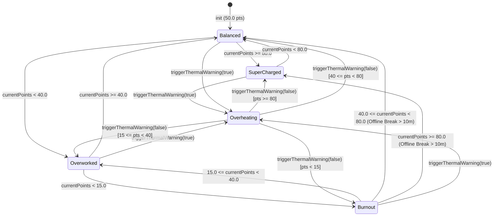

# Bitz State Machine & Wellness Point Engine Specification

## 1. Overview

Bitz's visual mood, animation speed, and LED visor telemetry are driven by the reactive `WellnessPointEngine` (`src/Services/WellnessPointEngine.swift`) bridged to the Rive state machine (`BitzStateMachine`) via the `BitzRiveControllable` protocol seam (`FR-002`, `FR-003`, `FR-004`, `C-004`).

---

## 2. Rive `BitzStateMachine` Input Contract

All Rive mutations target state machine `"BitzStateMachine"` inside asset `"bitz_cyber_cat"` (`BitzRiveInputName`):

| Input Identifier | Rive Type | Swift Type | Domain Range / Allowed Values | Purpose |
| :--- | :--- | :--- | :--- | :--- |
| `speedMultiplier` | `Number` | `Float` | `0.0 ... 2.5` (`2.0`, `1.0`, `0.4`, `0.0`) | Controls idle breathing, ear twitch, and tail wag animation playback speed. |
| `visorColor` | `Number` | `Float` | `0.0` (Cyan `#00F0FF`), `1.0` (Magenta `#FF007F`), `2.0` (Amber `#FFB000`), `3.0` (Red `#FF1E1E`) | Drives LED visor and internal ear/tail neon color blends. |
| `isStandby` | `Boolean` | `Bool` | `true` / `false` | Transitions Bitz into/out of curled loaf sleep mode (`"ZZZ"` visor). |
| `isGlitching` | `Boolean` | `Bool` | `true` / `false` | Enables/disables cyberpunk chromatic aberration and jitter during CPU thermal spikes. |
| `triggerPet` | `Trigger` | `Void` | One-shot impulse | Plays the happy purr / `<3` visor reaction when triggered from the Menu Bar. |

---

## 3. Wellness Scoring Mechanics (`WellnessPointEngine`)

- **Initial Score**: `50.0` points (`BitzState.balanced`).
- **Clamping Bounds**: `minPoints = 0.0`, `maxPoints = 100.0` (`0.0 ... 100.0`).
- **Work Tick Evaluation (`evaluateWorkTick(isProductiveApp:)`)**:
  - Productive Foreground App (`isProductiveApp == true`): **`+0.5` points** per tick.
  - Unproductive Foreground App (`isProductiveApp == false`): **`-1.5` points** per tick.
- **Offline Break Recovery (`applyOfflineBreak(minutes:)`)**:
  - When `minutes <= 10.0`: **`+0.0` points** (no change).
  - When `minutes > 10.0`: **`+5.0 * minutes` points**, clamped to `100.0`.
- **Default Productive Bundle IDs (`ActivityMonitorService.defaultProductiveBundleIDs`)**:
  - `com.apple.dt.Xcode`
  - `com.microsoft.VSCode`
  - `com.apple.Terminal`
  - `com.googlecode.iterm2`
  - `com.todesktop.230313mzl4w4u92` (Cursor)
  - `dev.warp.Warp-Stable`
  - `com.jetbrains.intellij`

---

## 4. Behavioral States & Threshold Mapping (`BitzState`)

| `BitzState` | Point Threshold | `speedMultiplier` | `visorColor` | `isStandby` | `isGlitching` | `activeSpeechBubbleText` | Visual Telemetry |
| :--- | :--- | :--- | :--- | :--- | :--- | :--- | :--- |
| `.superCharged` | `80.0 ... 100.0` | `2.0` | `1.0` (Magenta) | `false` | `false` | `nil` | High-energy bounce, neon magenta visor (`#FF007F`) |
| `.balanced` | `40.0 ..< 80.0` | `1.0` | `0.0` (Cyan) | `false` | `false` | `nil` | Calm breathing, electric cyan visor (`#00F0FF`) |
| `.overworked` | `15.0 ..< 40.0` | `0.4` | `2.0` (Amber) | `false` | `false` | `nil` | Drooping ears, sluggish motion, warning amber visor (`#FFB000`) |
| `.burnout` | `< 15.0` (`0.0 ..< 15.0`) | `0.0` | *(unchanged)* | `true` | `false` | `nil` | Curled loaf standby mode, dimmed `"ZZZ"` visor |
| `.overheating` | Thermal Override (`> 80.0°C` / `.critical` / `.serious`) | *(unchanged)* | `3.0` (Red) | *(unchanged)* | `true` | `"SYSTEM HOT! > <"` | Glitch animation, critical red visor (`#FF1E1E`), speech bubble banner |

---

## 5. State Transition Diagram

---

## 6. Thermal Override & Recovery Semantics

When `triggerThermalWarning(isOverheating: true)` is invoked:
1. `isOverheatingOverride` is set to `true`.
2. `currentState` immediately transitions to `.overheating` regardless of `currentPoints`.
3. `activeSpeechBubbleText` is set to `"SYSTEM HOT! > <"`.
4. `syncWithRive()` sets `isGlitching = true` and `visorColor = 3.0` (Red).
5. Any `evaluateWorkTick` or `applyOfflineBreak` calls while overheating continue to update `currentPoints` in the background without clearing `.overheating`.

When `triggerThermalWarning(isOverheating: false)` is invoked:
1. `isOverheatingOverride` is set to `false`.
2. `activeSpeechBubbleText` is cleared to `nil`.
3. `evaluateState()` recomputes the `BitzState` from `currentPoints` and calls `syncWithRive()`, restoring `isGlitching = false` and the point-appropriate `speedMultiplier`, `visorColor`, and `isStandby` values.
