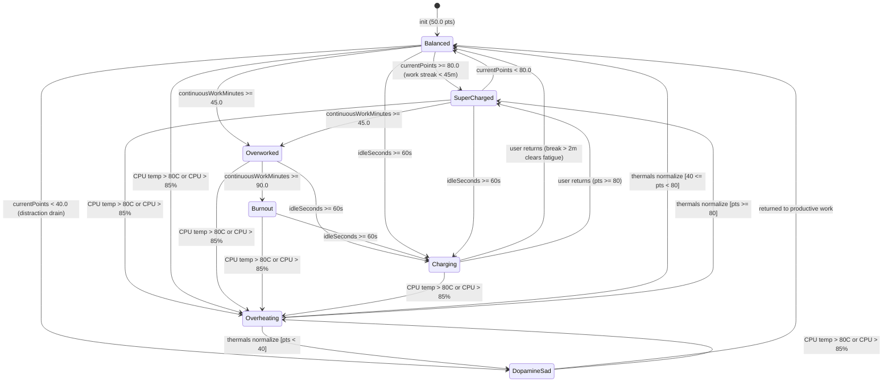

# Bitz State Machine & Wellness Point Engine Specification

## 1. Overview

Bitz's visual mood, animation speed, and LED visor telemetry are driven by the reactive `WellnessPointEngine` (`src/Services/WellnessPointEngine.swift`) bridged to the Rive state machine (`BitzStateMachine`) via the `BitzRiveControllable` protocol seam (`FR-002`, `FR-003`, `FR-004`, `C-004`).

---

## 2. Rive `BitzStateMachine` Input Contract

All Rive mutations target state machine `"BitzStateMachine"` inside asset `"bitz_cyber_cat"` (`BitzRiveInputName`):

| Input Identifier | Rive Type | Swift Type | Domain Range / Allowed Values | Purpose |
| :--- | :--- | :--- | :--- | :--- |
| `speedMultiplier` | `Number` | `Float` | `0.0 ... 2.5` (`2.0`, `1.0`, `0.6`, `0.4`, `0.35`, `0.0`) | Controls idle breathing, ear twitch, paws trot, and tail wag playback speed. |
| `visorColor` | `Number` | `Float` | `0.0` (Cyan `#00F0FF`), `1.0` (Magenta `#FF007F`), `2.0` (Amber `#FFB000`), `3.0` (Red `#FF1E1E`), `4.0` (Violet `#9D4EDD`), `5.0` (Green `#00FF88`) | Drives LED visor and internal ear/tail neon color blends. |
| `isStandby` | `Boolean` | `Bool` | `true` / `false` | Transitions Bitz into/out of curled loaf sleep/charging mode. |
| `isGlitching` | `Boolean` | `Bool` | `true` / `false` | Enables/disables cyberpunk chromatic aberration and jitter during CPU thermal spikes. |
| `triggerPet` | `Trigger` | `Void` | One-shot impulse | Plays the happy purr / `<3` visor reaction when triggered from the Menu Bar. |

---

## 3. Wellness Scoring Mechanics (`WellnessPointEngine`)

- **Initial Score**: `50.0` points (`BitzState.balanced`).
- **Clamping Bounds**: `minPoints = 0.0`, `maxPoints = 100.0` (`0.0 ... 100.0`).
- **Work Tick Evaluation (`evaluateWorkTick(isProductiveApp:)`)**:
  - Productive Foreground App / Whitelisted Tab (`isProductiveApp == true`): **`+0.5` points** per tick (increases continuous work streak).
  - Unproductive Streaming / Distraction Site (`isProductiveApp == false`): **`-1.5` points** per tick (drains into `.dopamineSad` when $< 40$ PTS).
- **Charging Idle Mode (`setChargingState(true)`)**:
  - Recharges **`+0.5` points** per tick and reduces continuous work fatigue when away from keyboard $\ge 60$s.
- **Offline Break Recovery (`applyOfflineBreak(minutes:)`)**:
  - When `minutes <= 2.0`: **`+0.0` points** (no change).
  - When `minutes > 2.0`: **`+5.0 * minutes` points**, clamped to `100.0`, and resets continuous work streak to `0.0m`.
- **Work Fatigue Streaks**:
  - Continuous work $\ge 45$ min without a break transitions to **`.overworked`** (`-  -`).
  - Continuous work $\ge 90$ min without a break transitions to **`.burnout`** (`X  X`).

---

## 4. Behavioral States & Threshold Mapping (`BitzState`)

| `BitzState` | Point / Streak Condition | `speedMultiplier` | `visorColor` | `isStandby` | `isGlitching` | `activeSpeechBubbleText` | Visual Telemetry |
| :--- | :--- | :--- | :--- | :--- | :--- | :--- | :--- |
| **`.superCharged`** | `80.0 ... 100.0` PTS ($< 45$m work) | `2.0` | `1.0` (Magenta `#FF007F`) | `false` | `false` | `nil` | High-energy trot, neon sparks drifting, `^  ^` visor |
| **`.balanced`** | `40.0 ..< 80.0` PTS ($< 45$m work) | `1.0` | `0.0` (Cyan `#00F0FF`) | `false` | `false` | `nil` | Steady breathing & paws, floating binary bits, blinking cyan eyes |
| **`.dopamineSad`** | $< 40.0$ PTS (Streaming/distraction drain) | `0.35` | `4.0` (Violet `#9D4EDD`) | `false` | `false` | `"DOPAMINE OVERLOAD — BACK TO FOCUS?"` | Drooping ears, crying `T  T` visor |
| **`.overworked`** | Work streak $\ge 45$ min without break | `0.4` | `2.0` (Amber `#FFB000`) | `false` | `false` | `"WORKING NON-STOP — TAKE A QUICK BREAK ☕"` | Sluggish walk, tired `-  -` squint visor |
| **`.burnout`** | Work streak $\ge 90$ min without break | `0.0` | `2.0` (Amber `#FFB000`) | `true` | `false` | `"BURNOUT! STEP AWAY FOR 5 MIN TO RECHARGE 💤"` | Curled loaf posture, exhausted `X  X` visor |
| **`.charging`** | Idle $\ge 60$s without mouse/keyboard input | `0.6` | `5.0` (Emerald Green `#00FF88`) | `true` | `false` | `"CHARGING ENERGY... ⚡"` | Cozy loaf posture, `⚡ Z Z` visor, drifting `Zzz` particles |
| **`.overheating`** | Thermal Override ($> 80.0^\circ\text{C}$ or $> 85\%$ CPU) | `2.5` | `3.0` (Critical Red `#FF1E1E`) | *(prior)* | `true` | `"🔥 ... CLOSE HEAVY APPS TO COOL DOWN!"` | Glitch vibration, steam puffs from ears, `>  <` visor |

---

## 5. State Transition Diagram

