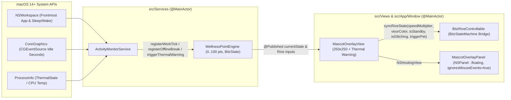

# Implementation Plan: Bitz the Cyber Cat macOS Desktop Companion

**Branch**: `feat/bitz-macos-mascot` | **Date**: 2026-10-25 | **Spec**: [spec.md](file:///Users/akramkasimi/Documents/bitz-mac/kitty-specs/bitz-macos-mascot-01M5R2H1/spec.md)  
**Input**: Feature specification from `/Users/akramkasimi/Documents/bitz-mac/kitty-specs/bitz-macos-mascot-01M5R2H1/spec.md`

---

## Summary

Implement **Bitz the Cyber Cat** (`bitz-mac`), a native macOS 14.0+ desktop companion built with Swift 6, SwiftUI, AppKit, CoreGraphics, and the `BitzStateMachine` Rive contract. Bitz floats unobtrusively in the bottom-right visible screen frame (`250x250` pt) inside a borderless, transparent, non-activating, click-through `NSPanel` (`MascotOverlayPanel`, `ignoresMouseEvents = true`, zero desktop wallpaper modification). A `@MainActor` `WellnessPointEngine` tracks user work-life balance (`0.0...100.0` points, starting at `50.0`) and system thermal state across five modes (`.superCharged`, `.balanced`, `.overworked`, `.burnout`, `.overheating`), fed by `ActivityMonitorService` (`NSWorkspace` active app classification, CoreGraphics idle duration, sleep/wake/screen-lock events, and `ProcessInfo.ThermalState`), driving `MascotOverlayView` and the `BitzStateMachine` Rive inputs (`speedMultiplier`, `visorColor`, `isStandby`, `isGlitching`, `triggerPet`) within `< 2%` CPU on Apple Silicon and `< 70MB` RAM at 60 FPS.

---

## Technical Context

**Language/Version**: Swift 6.0 (`swift-tools-version: 6.0`) with strict concurrency checking
**Primary Dependencies**: Apple System Frameworks (`SwiftUI`, `AppKit`, `CoreGraphics`, `Foundation`, `Combine`) + `BitzRiveControllable` adapter seam for `RiveRuntime` (`rive-ios` >= 6.0.0)
**Storage**: In-memory `@MainActor` observable state (`WellnessPointEngine`, `ActivityMonitorService`); no external database required
**Testing**: `XCTest` / Swift Testing via `swift test` with deterministic dependency injection (`>= 80%` line coverage across `WellnessPointEngine` and `ActivityMonitorService`)
**Target Platform**: macOS 14.0+ (Sonoma or newer), Universal architecture (`arm64` Apple Silicon & `x86_64` Intel)
**Project Type**: single — Native macOS Swift Package (`BitzCore` library target, `BitzApp` executable target, `BitzTests` test target)
**Performance Goals**: 60 FPS mascot rendering, `< 2%` CPU utilization on Apple Silicon (`NFR-001`), `< 70MB` resident RAM footprint (`NFR-002`)
**Constraints**: `MascotOverlayPanel.ignoresMouseEvents == true` (`C-002`), zero desktop wallpaper modification (`C-001`), zero compiler warnings (`NFR-004`)
**Scale/Scope**: Single-user local macOS desktop companion (`4` core Swift modules, `1` app entry point, `3` living architecture documents in `docs/`, comprehensive unit test suite)

---

## Charter Check

*GATE: Must pass before Phase 0 research. Re-checked and verified after Phase 1 design.*

| Governance ID | Title / Rule | Status | Verification in Plan |
| :--- | :--- | :--- | :--- |
| `PROJECT_001` | Mission Type and Scope Boundary | **PASS** | Scoped strictly to native macOS desktop companion (`MascotOverlayPanel`, `WellnessPointEngine`, `ActivityMonitorService`, `MascotOverlayView`, `BitzApp`, `Tests/`, and `docs/`). |
| `PROJECT_002` / `DIR-001` / `DIR-002` | Overlay Click-Through, Non-Interference & Resource Cap | **PASS** | Enforced in [overlay-window-contract.md](file:///Users/akramkasimi/Documents/bitz-mac/kitty-specs/bitz-macos-mascot-01M5R2H1/contracts/overlay-window-contract.md): `ignoresMouseEvents = true`, zero `setDesktopImageURL` calls, 60s telemetry interval for `< 2%` CPU and `< 70MB` RAM. |
| `DIRECTIVE_001` | Architectural Integrity & Separation of Concerns | **PASS** | Clean 4-component separation: Windowing (`MascotOverlayPanel`), Domain Engine (`WellnessPointEngine`), Telemetry (`ActivityMonitorService`), and Presentation (`MascotOverlayView` + `BitzRiveControllable`). |
| `DIRECTIVE_010` | Specification Fidelity | **PASS** | Every `FR-001`–`FR-007`, `NFR-001`–`NFR-004`, and `C-001`–`C-004` maps directly to `IC-01`–`IC-04` below and [rive-state-machine-contract.md](file:///Users/akramkasimi/Documents/bitz-mac/kitty-specs/bitz-macos-mascot-01M5R2H1/contracts/rive-state-machine-contract.md). |
| `DIRECTIVE_034` | Test-First Development | **PASS** | TDD workflow (`testing-philosophy-tactic`) enforced for `WellnessPointEngine`, `ActivityMonitorService`, and `MascotOverlayPanel` invariants with `>= 80%` coverage. |
| `DIRECTIVE_037` / `DIR-005` | Living Documentation Sync | **PASS** | `IC-04` delivers and validates `docs/ARCHITECTURE.md`, `docs/STATE_MACHINE.md`, and `docs/ACCEPTANCE_CRITERIA.md` in lockstep with code. |

---

## Architecture & Data Flow



---

## Project Structure

### Documentation (this mission)

```text
kitty-specs/bitz-macos-mascot-01M5R2H1/
├── spec.md                                  # Mission specification (FR-001..FR-007, NFR-001..NFR-004, C-001..C-004)
├── plan.md                                  # This implementation plan
├── research.md                              # Phase 0 architectural & supply-chain research decisions
├── data-model.md                            # Phase 1 domain entities, state table & invariants
├── quickstart.md                            # Phase 1 developer build/run/test quickstart
├── contracts/
│   ├── overlay-window-contract.md           # MascotOverlayPanel AppKit property & placement contract
│   └── rive-state-machine-contract.md       # BitzStateMachine Rive input & transition contract
└── tasks.md                                 # Phase 2 work-package breakdown (created by /spec-kitty.tasks)
```

### Source Code (repository root)

```text
Package.swift                                # Swift 6 package manifest (BitzCore, BitzApp, BitzTests)
docs/
├── ARCHITECTURE.md                          # Living system architecture & windowing spec
├── STATE_MACHINE.md                         # Living BitzStateMachine & wellness scoring spec
└── ACCEPTANCE_CRITERIA.md                   # Living Definition of Done & verification checklist
src/
├── App/
│   ├── BitzApp.swift                        # @main NSApplicationDelegate & SwiftUI app entry point
│   └── Window/
│       └── MascotOverlayPanel.swift         # Borderless, transparent, click-through floating NSPanel
├── Services/
│   ├── WellnessPointEngine.swift            # 0..100 wellness state engine & Rive parameter publisher
│   └── ActivityMonitorService.swift         # NSWorkspace, CoreGraphics idle & thermal telemetry service
└── Views/
    └── MascotOverlayView.swift              # 250x250 SwiftUI view, BitzStateMachine bridge & warning bubble
Tests/
└── BitzTests/
    ├── WellnessPointEngineTests.swift       # Unit tests for scoring, clamping, thresholds & thermal override
    ├── ActivityMonitorServiceTests.swift    # Unit tests for app classification, offline breaks & thermals
    └── MascotOverlayPanelTests.swift        # Unit tests for NSPanel click-through & window invariants
```

**Structure Decision**: A single Swift 6 package rooted at `Package.swift` with `src/` split into `BitzCore` (containing `src/App/Window/MascotOverlayPanel.swift`, `src/Services/WellnessPointEngine.swift`, `src/Services/ActivityMonitorService.swift`, and `src/Views/MascotOverlayView.swift` so all components are directly importable and testable by `BitzTests`), `BitzApp` (`src/App/BitzApp.swift` executable), `Tests/BitzTests/`, and `docs/` matching the exact paths specified in `AGENT_INSTRUCTIONS.md.docx` and `PROJECT_BLUEPRINT.md.docx`.

---

## Complexity Tracking

No Charter Check violations exist; no complexity exceptions required.

---

## Implementation Concern Map

### IC-01 — Swift Package Foundation & `WellnessPointEngine` Domain Core

- **Purpose**: Establish `Package.swift` (`Swift 6`, `macOS 14.0+`) and implement `WellnessPointEngine` (`BitzState`, point scoring, `0.0...100.0` clamping, threshold evaluation, thermal override, and Rive parameter publishing) with comprehensive TDD unit tests.
- **Relevant requirements**: `FR-002`, `FR-003`, `FR-004`, `NFR-003`, `NFR-004`, `C-003`, `C-004`
- **Affected surfaces**: `Package.swift`, `src/Services/WellnessPointEngine.swift`, `Tests/BitzTests/WellnessPointEngineTests.swift`
- **Sequencing/depends-on**: none
- **Risks**: Off-by-one errors at threshold boundaries (`80.0`, `40.0`, `15.0`, `10.0` min break) or losing underlying `points` updates while `.overheating` is active; mitigated by boundary-value unit tests.

### IC-02 — `ActivityMonitorService` System Telemetry & Idle/Thermal Detection

- **Purpose**: Implement `ActivityMonitorService` with injectable protocols for `NSWorkspace` active app classification, CoreGraphics idle time / offline break calculation (`> 10` minutes), and `ProcessInfo.ThermalState` / CPU temperature (`> 80°C`) monitoring driving `WellnessPointEngine`.
- **Relevant requirements**: `FR-005`, `NFR-001`, `NFR-002`, `NFR-003`, `NFR-004`
- **Affected surfaces**: `src/Services/ActivityMonitorService.swift`, `Tests/BitzTests/ActivityMonitorServiceTests.swift`
- **Sequencing/depends-on**: `IC-01`
- **Risks**: Direct coupling to `NSWorkspace.shared` or `CGEventSource` would prevent deterministic unit testing; mitigated by protocol-based telemetry injection with default macOS system implementations.

### IC-03 — `MascotOverlayPanel`, `MascotOverlayView` Rive Bridge & App Lifecycle

- **Purpose**: Implement `MascotOverlayPanel` (`NSPanel` subclass with `ignoresMouseEvents = true`, `.nonactivatingPanel`, `.borderless`, `.floating`, `.canJoinAllSpaces`), `MascotOverlayView` (`BitzStateMachine` Rive input synchronization, vector fallback, and `"SYSTEM HOT! > <"` warning bubble), and `BitzApp` entry point with window/view unit tests.
- **Relevant requirements**: `FR-001`, `FR-004`, `FR-006`, `NFR-001`, `NFR-002`, `NFR-004`, `C-001`, `C-002`, `C-003`
- **Affected surfaces**: `src/App/Window/MascotOverlayPanel.swift`, `src/Views/MascotOverlayView.swift`, `src/App/BitzApp.swift`, `Tests/BitzTests/MascotOverlayPanelTests.swift`
- **Sequencing/depends-on**: `IC-01`, `IC-02`
- **Risks**: Missing binary `bitz_mascot.riv` resource causing runtime force-unwrap crash; mitigated by `BitzRiveControllable` safe resource lookup and vector canvas fallback.

### IC-04 — Living Documentation & End-to-End Acceptance Verification

- **Purpose**: Author `docs/ARCHITECTURE.md`, `docs/STATE_MACHINE.md`, and `docs/ACCEPTANCE_CRITERIA.md` synchronized with the implemented Swift modules and verify all build, test coverage (`>= 80%`), and charter quality gates.
- **Relevant requirements**: `FR-007`, `NFR-001`, `NFR-002`, `NFR-003`, `NFR-004`, `C-001`, `C-002`
- **Affected surfaces**: `docs/ARCHITECTURE.md`, `docs/STATE_MACHINE.md`, `docs/ACCEPTANCE_CRITERIA.md`
- **Sequencing/depends-on**: `IC-01`, `IC-02`, `IC-03`
- **Risks**: Documentation drift between `docs/` and `src/`; mitigated by cross-checking exact symbol names, state thresholds, and window properties against the test suite.
